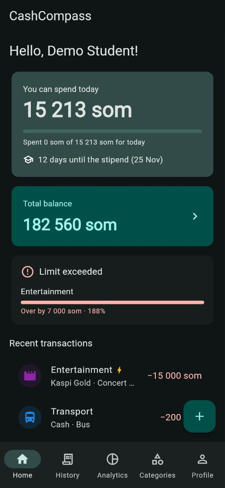
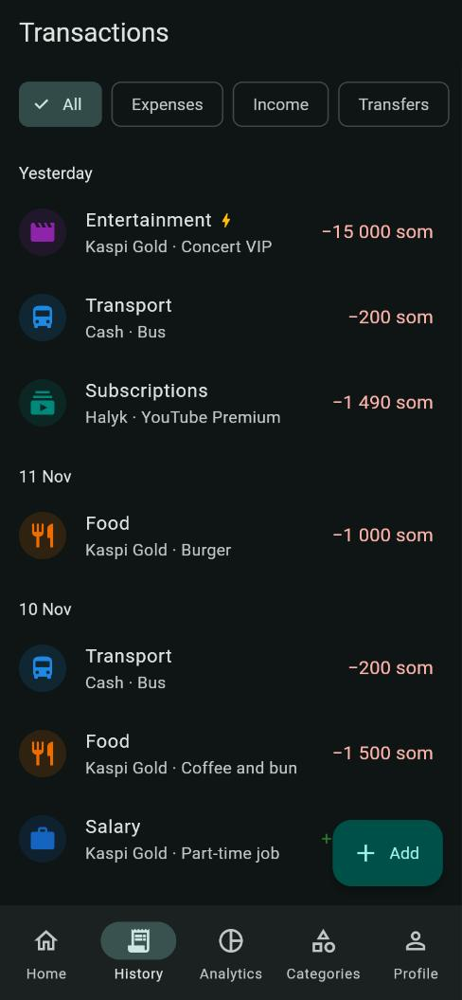
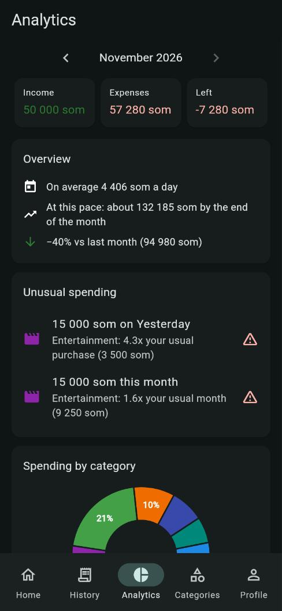
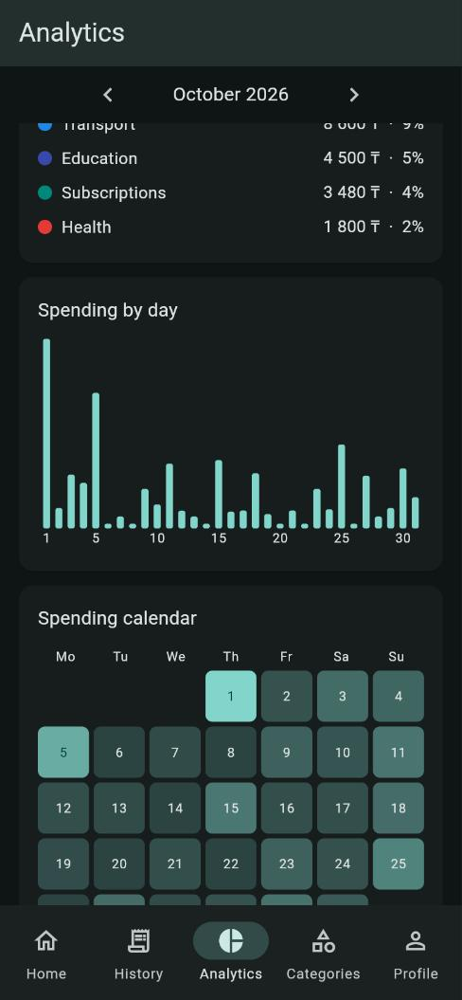
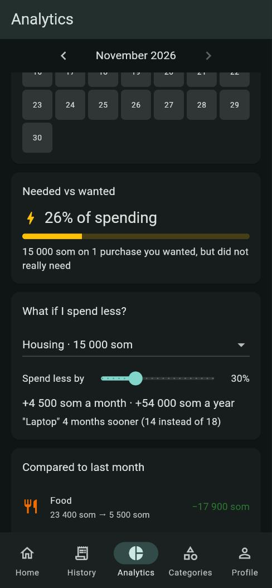
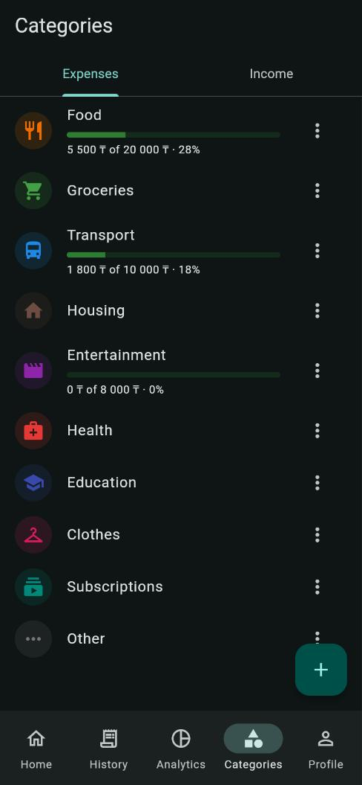
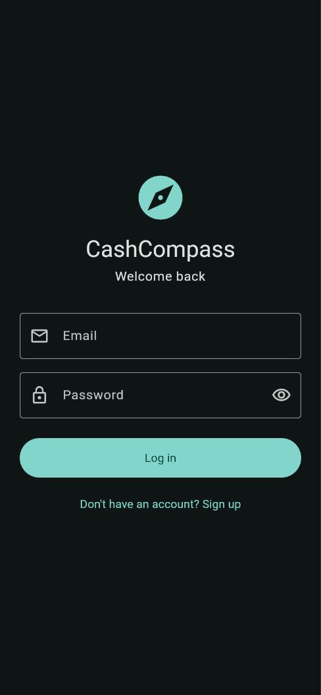
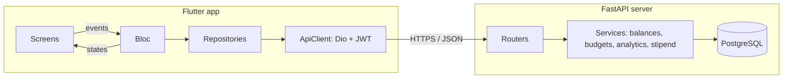

# CashCompass

**Budget analytics app for students.** All your money — cash and every bank card — in one place,
clear spending analytics, and one simple answer every morning:
*"How much can I spend today to make it to the next stipend?"*

[](https://github.com/NargizaAlieva/cash-compass/actions/workflows/ci.yml)

- **Live API:** https://cash-compass-api.onrender.com
- **API docs (Swagger):** https://cash-compass-api.onrender.com/docs
- **Demo account:** `demo@cashcompass.app` / `demo12345` (about 3 months of sample data)

> The server runs on Render's free plan and sleeps after 15 minutes without requests.
> The first request after that can take up to a minute.

## Screenshots

| Home | History | Analytics | Charts |
|---|---|---|---|
|  |  |  |  |

| Needed vs wanted | Limits | Login |
|---|---|---|
|  |  |  |

## Features

**Core**
- Sign up / log in with JWT, the session is kept between app starts
- Accounts: cash and cards, total balance
- Income, expenses and transfers between accounts; balances are updated by the server
- Categories with icons and colors (14 ready-made ones for every new user)
- History grouped by day with filters

**What makes it different**
- **Until-stipend budget** — "You can spend 3 462 ₸ today · 13 days until the stipend".
  The daily number is calculated from this morning's money, so it does not jump after every purchase.
- **Impulse purchase index** — mark a purchase as "wanted, not needed" and see what share of the
  month went to impulses.
- **Category limits** — "Food: 20 000 ₸ a month" with green / yellow (80%) / red (100%) progress
  and a warning on the Home screen.
- **Analytics** — pie chart by category, spending by day, a spending heatmap calendar,
  comparison with last month, average per day and a forecast for the end of the month.
- **Regular payments** — rent, subscriptions, phone: the server adds them every month by itself
  (missed months included, never twice). Payments due before the stipend are put aside,
  so the daily budget stays honest.
- **Savings goals** — "Laptop 400 000 ₸ → at this pace: March 2027", based on the average saving
  of the last 3 months.
- **What-if simulator** — "spend 30% less on Food" → money per month and per year, and how many
  months sooner a goal is reached. Calculated on the phone, instantly.
- **Unusual spending detector** — finds a purchase far above what is usual for its category
  (median + 3·MAD, robust to old outliers) and categories whose month is 1.5× the usual one.

## Course requirements

| Requirement | How it is done |
|---|---|
| Cross-platform mobile app (Flutter) | One Flutter code base for Android, iOS and Web (`mobile/`) |
| Mobile communicates with a server | Own REST API on FastAPI (`server/`), deployed on Render with PostgreSQL. All calculations (balances, limits, analytics, stipend budget) are done on the server |
| Pushed on GitHub | Every feature in its own branch and pull request, GitHub Actions runs analysis and all tests on every push |
| State management (Bloc) | 9 Blocs with events and states: `AuthBloc`, `AccountsBloc`, `CategoriesBloc`, `TransactionsBloc`, `BudgetsBloc`, `AnalyticsBloc`, `StipendBloc`, `RecurringBloc`, `GoalsBloc`, each covered by `bloc_test` |

## Architecture



- **Screens** only show states and send events. They never call the network.
- **Blocs** hold the logic of the app and never know about HTTP.
- **Repositories** turn JSON into Dart models.
- **Blocs talk through listeners.** When `TransactionsBloc` saves a change, a listener in
  `MainShell` asks `AccountsBloc`, `BudgetsBloc`, `AnalyticsBloc`, `StipendBloc` and `GoalsBloc`
  to reload. A change of a regular payment reloads transactions and balances the same way.
  The Blocs do not know about each other.

## Tech stack

| Part | Tools |
|---|---|
| Mobile | Flutter, `flutter_bloc`, `equatable`, `dio`, `flutter_secure_storage`, `fl_chart`, `intl` |
| Mobile tests | `flutter_test`, `bloc_test`, `mocktail` |
| Server | Python 3.13, FastAPI, SQLAlchemy 2, Pydantic, PyJWT, bcrypt |
| Database | SQLite locally, PostgreSQL in production, Alembic migrations |
| Server tests | `pytest` (in-memory SQLite, also checked on PostgreSQL) |
| CI / CD | GitHub Actions, Render Blueprint (`render.yaml`) |

## Project structure

```
cash-compass/
├── mobile/                  Flutter app
│   ├── lib/
│   │   ├── core/            API client, config, shared widgets
│   │   └── features/        one folder per feature: data / bloc / ui
│   │       ├── auth/  accounts/  categories/  transactions/
│   │       ├── budgets/  analytics/  stipend/  recurring/  goals/
│   │       └── home/  profile/  shell/
│   └── test/                Bloc and model tests
├── server/                  FastAPI server
│   ├── app/
│   │   ├── routers/         HTTP endpoints
│   │   ├── services/        calculations (balances, budgets, analytics, stipend,
│   │   │                    recurring payments, goals, anomalies)
│   │   ├── models/          database tables
│   │   └── schemas/         request and response formats
│   ├── scripts/seed_demo.py demo data
│   └── tests/
├── render.yaml              deploy: web service + PostgreSQL
└── .github/workflows/ci.yml
```

## API

All endpoints except `/health`, `/auth/register` and `/auth/login` need `Authorization: Bearer <token>`.
Users only see their own data.

| Area | Endpoints |
|---|---|
| Auth | `POST /auth/register`, `POST /auth/login`, `GET /auth/me`, `PUT /auth/me` |
| Accounts | `GET /accounts` (with total), `POST /accounts`, `PUT /accounts/{id}`, `DELETE /accounts/{id}` |
| Categories | `GET /categories?kind=`, `POST`, `PUT /categories/{id}`, `DELETE /categories/{id}` |
| Transactions | `GET /transactions?date_from=&date_to=&kind=&account_id=&category_id=&q=`, `GET/POST/PUT/DELETE` |
| Limits | `GET /budgets?month=`, `PUT /budgets/{category_id}`, `DELETE /budgets/{category_id}` |
| Analytics | `GET /analytics/month?month=2026-11` (also returns unusual spending) |
| Stipend | `GET /stipend/allowance` |
| Regular payments | `GET /recurring` (with monthly/yearly totals), `POST`, `PUT /recurring/{id}`, `DELETE /recurring/{id}` |
| Goals | `GET /goals` (with saving pace and forecasts), `POST`, `PUT /goals/{id}`, `DELETE /goals/{id}` |

Full interactive docs: https://cash-compass-api.onrender.com/docs

## Run locally

**Server**
```
cd server
python -m venv .venv
.venv\Scripts\python.exe -m pip install -r requirements.txt
copy .env.example .env
.venv\Scripts\python.exe -m uvicorn app.main:app --reload
```
Open http://127.0.0.1:8000/docs. Put your own random `SECRET_KEY` into `.env`.

**App**
```
cd mobile
flutter pub get
flutter run -d chrome
```
In debug mode the app uses the local server (`http://10.0.2.2:8000` on the Android emulator).
Release builds use the server on Render:
```
flutter build apk --release
```
Any server can be chosen with `--dart-define=API_URL=https://...`.

**Demo data**
```
cd server
.venv\Scripts\python.exe scripts\seed_demo.py
.venv\Scripts\python.exe scripts\seed_demo.py --url https://cash-compass-api.onrender.com
```
Creates the demo account with 3 accounts, limits, stipend settings and about 150 transactions
for the last three months. Today is left empty, so a purchase can be added live during a demo.

## Tests

```
cd server
.venv\Scripts\python.exe -m pytest      # 127 tests

cd mobile
flutter analyze
flutter test                            # 59 tests
```

Both run automatically in GitHub Actions on every push and pull request.

## Database migrations

The database schema is managed by Alembic (`server/alembic/versions`). The server applies new
migrations on startup, locally and on Render. After changing a model:
```
cd server
.venv\Scripts\python.exe -m alembic revision --autogenerate -m "what changed"
```
A test fails if a model and the migrations do not match.

## Deploy

The server is deployed with a Render Blueprint: `render.yaml` describes a Python web service
and a PostgreSQL database. Render installs `server/requirements.txt`, starts Uvicorn, checks
`/health`, and redeploys on every push to `main`. The JWT secret is generated by Render.
